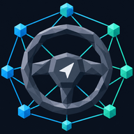

# MeshDrive

Drive an RC car from anywhere, over 4G/5G, with two Android phones.

One phone rides in the car: it streams live video and audio and drives the servos through a
small ESP32 board. The other phone is the remote, with touch controls or a gamepad. The two
phones talk to each other directly over the [Yggdrasil](https://yggdrasil-network.github.io/)
mesh network, which is built into the app. There is no server, no account, no port forwarding,
and it works behind carrier NAT.

```
 ┌──────────────── controller phone ───────────────┐                ┌───────────────── vehicle phone ─────────────────┐
 │ touch sliders / gamepad ──► control  (UDP 7861) ─┼───────────────►│ ControlLink ──► ServoLink ──USB/BLE──► ESP32 ──► servos/ESC
 │ live video  ◄──────────────  video   (UDP 7862) ◄┼── Yggdrasil ───┤◄── camera (H.264)
 │ speaker     ◄──────────────  audio   (UDP 7863) ◄┼──   mesh   ────┤◄── microphone (AAC)
 │ talk-back mic ───────────►   audio   (UDP 7864) ─┼───────────────►│──► speaker
 └──────────────────────────────────────────────────┘                └──────────────────────────────────────────────────┘
          every packet HMAC-signed with the vehicle's pairing secret · Yggdrasil encrypts end to end
```

> **Version 1.0 changed the control protocol.** Both phones must run MeshDrive 1.0 or newer.
> A 1.0 controller warns when the vehicle runs an older version. An older controller sees a
> 1.0 vehicle as offline.

## Contents

- [How it works](#how-it-works)
- [Features](#features)
- [Safety](#safety)
- [Hardware](#hardware)
- [Getting started](#getting-started)
- [Network and protocol](#network-and-protocol)
- [Building from source](#building-from-source)
- [Known limitations](#known-limitations)
- [License](#license)

## How it works

**One app, two modes.** At startup you choose *Controller* or *Vehicle*. Any Android phone
(8.0+, arm64) can take either role.

**Yggdrasil is built in.** MeshDrive bundles its own Yggdrasil node (yggdrasil-go, compiled
with gomobile) and runs it as an Android `VpnService`. You don't need the separate Yggdrasil
app. Each phone gets a stable IPv6 address in `200::/7` that the other phone can reach from
anywhere, on any network. Yggdrasil encrypts all traffic between the two phones.

**Plain UDP, no WebRTC.** Control, video and audio are separate UDP streams sent straight
between the two Yggdrasil addresses. WebRTC was tried and dropped: its ICE candidate gathering
never sees the Yggdrasil tunnel interface on a cellular-only phone.

**Pairing by QR code.** When the vehicle phone first starts, it generates a 32-byte secret.
Its screen shows a QR code holding its Yggdrasil address and that secret. The controller scans
it once, and the vehicle is saved under a friendly name in the *Recent vehicles* list, with a
live online/offline dot.

**The ESP32 board does the PWM.** The vehicle phone sends simple text commands
(`PosJ<channel>=<µs>`) to an ESP32 servo board, normally over a USB-OTG cable. The board
generates the servo and ESC signals. The app asks the board which channels steer and throttle
are on, and what their calibrated min/center/max are. It never guesses.

## Features

### Connectivity
- **Embedded Yggdrasil node**, no separate app needed. The node identity (private key) is
  kept, so a vehicle keeps its address and its QR code stays valid.
- **Automatic peer selection.** Candidate peers are probed in parallel and the fastest
  reachable one is used. The app re-checks regularly and switches only when another peer is
  clearly better (at least 30% faster) and the connection has settled, so measurement noise
  doesn't cause reconnects.
- **Up-to-date peer list.** The public peer list is refreshed monthly from
  [yggdrasil-network/public-peers](https://github.com/yggdrasil-network/public-peers). A
  built-in snapshot is used offline. A cached list that turns out to be unusable is discarded
  automatically.
- **Custom peers** (`tcp://`, `tls://`, `quic://`) can replace the built-in list, for example
  your own node.
- **Self-healing.** Wifi/cellular handovers, a dead session and network changes trigger a
  redial and refresh the sockets, without restarting the app.
- **VPN conflict handling.** Android allows only one VPN at a time. MeshDrive warns before it
  would disconnect another VPN (WireGuard, Defender Web Protection, …). If another app takes
  the VPN slot mid-session, MeshDrive takes it back as soon as it is free again.

### Driving
- **Touch controls**: a horizontal steering slider and a vertical throttle slider. Both snap
  back to center on release. The controller sends at a steady ~33 Hz.
- **Gamepad support** (e.g. a Logitech F310 in XInput mode, via USB-OTG): left stick X
  steers, right stick Y is throttle, **LB** shows the rear view while held, **B** starts and
  stops recording. Touch and gamepad can be used together; the input that moved last wins.
- **Safe steering**: the faster the car goes (GPS speed), the less steering it gets, which
  prevents rollovers. Maximum speed and reduction can be tuned live in debug mode.
- **One driver at a time.** The first controller to send commands owns the vehicle. A second
  controller gets a "Vehicle already connected to another controller" message. Its commands
  are not mixed in. Ownership is released after 2 seconds of silence.

### Video and audio
- **Hardware H.264**: Camera2 writes straight into the hardware encoder; the controller
  decodes straight to the screen.
- **Quality presets**, chosen on the controller and applied on the vehicle:

  | Preset   | Resolution | Bitrate   | FPS | Vehicle audio |
  |----------|------------|-----------|-----|---------------|
  | High     | 1280×960   | 1.5 Mbit/s| 20  | on            |
  | Medium   | 640×480    | 800 kbit/s| 20  | on            |
  | Low      | 320×240    | 80 kbit/s | 20  | on            |
  | Ultra Low| 320×240    | 40 kbit/s | 10  | off           |

- **Auto quality**: steps one preset down after 3 s below 12 fps, and back up after 6 s above
  18 fps.
- **Rear view**: switches the vehicle to its front camera (toggle button, or hold LB).
- **Correct orientation**: the vehicle's accelerometer tells the controller how the phone is
  mounted, so the picture is upright however the phone is fixed in the car.
- **Two-way audio**: ambient/engine sound from the vehicle (mono AAC, 16 kHz, 32 kbit/s), and
  talk-back from the controller's microphone (with echo cancellation). One *Mute* button
  silences both.

### Recording and telemetry
- **Recording on the controller**: the received video and audio are saved as MP4 in
  `Movies/MeshDrive`, without re-encoding.
- **GPX track**: while GPS telemetry is on, a `.gpx` file with route and speed is saved next
  to each recording.
- **GPS/speed overlay**: the vehicle's speed and position, shown live on the controller.
  The vehicle only uses GPS while the overlay or *Safe steering* is on.

### Vehicle board management
- **Firmware updates for the ESP32**: the vehicle phone checks GitHub for newer board
  firmware, downloads it, and installs it through the board's own wifi access point.
- **Servo settings**: one tap opens the board's own web interface (`http://192.168.4.1`).
- **Runs in the background**: vehicle mode is a foreground service. Driving, video and audio
  keep working with the vehicle phone's screen locked.

### Diagnostics
- **Debug mode**: Yggdrasil addresses, peer status, FPS/latency/bandwidth overlay, manual
  addresses, the speed-limiter tuning, and a live log.
- **Log to file**: the app's own logcat is written to a file on the phone, which survives the
  network changes that would break an `adb logcat` session.

## Safety

An RC car that keeps driving on its last command is dangerous. MeshDrive has several
independent layers, so that losing the connection, a slow connection, or a stuck input always
ends with the car at neutral (servos centered, throttle off):

| Situation | What happens |
|---|---|
| No control packets for 300 ms | The vehicle phone sets steering and throttle to the board's calibrated center, and keeps sending neutral at 10 Hz until fresh input arrives. |
| Packets keep arriving, but late (congested or overloaded link) | Each control frame carries its send time. The vehicle drops frames that arrive more than 300 ms later than the fastest path it has measured, so the 300 ms failsafe takes over. Works without synchronized clocks. The controller shows *"Too much delay – vehicle stopped"*. |
| The link stays slow | After 3 s the vehicle accepts the new delay, but only once the driver releases the throttle, so the car never pulls away on an old, held command. |
| Reordered or duplicated packets | Dropped. Only frames newer than the last one applied are used. |
| Vehicle app dies or USB cable is pulled | The ESP32 firmware has its own failsafe: neutral after 500 ms without commands. |
| Controller app goes to the background or the screen locks | The controller stops sending, so the vehicle goes to neutral. |
| Gamepad unplugged, or a system dialog takes focus while you hold the stick | The controller sets steering and throttle to 0 straight away. |
| USB/BLE hiccup between phone and board | Board commands go through one ordered, bounded queue: an old command can never be written after a newer one, and no backlog builds up. |
| A second controller | Rejected while the first one is driving (see *One driver at a time*). |

The vehicle also stops its video and audio after 20 s without a controller, to save battery
and data.

## Hardware

### Phones
- Two Android phones, Android 8.0 or newer, **arm64**.
- Mobile data, wifi, or both. They don't need to be on the same network.
- The vehicle phone needs USB-OTG (practically every phone with USB-C), plus a short
  USB-C cable to the ESP32 board.

### ESP32 servo board
MeshDrive drives one of these boards (open source firmware, flashed separately):

| Board | Firmware | Board wifi AP |
|---|---|---|
| Classic ESP32 servo tester | [esp32-servo-tester](https://github.com/MichielBruijn/esp32-servo-tester) | `ServoTester` |
| ESP32-C3 Super Mini controller | [esp32-c3-servo-controller](https://github.com/MichielBruijn/esp32-c3-servo-controller) | `MespDrive` |

- **USB-OTG serial (115200 baud) is the main link.** It lets the vehicle phone stay on mobile
  data while controlling the board.
- **Bluetooth LE** (Nordic UART service, ESP32-C3) is available as an alternative but has
  not been tested on real hardware yet.
- Give the servos/ESC their own power supply, not the ESP32's 5 V pin: shared power causes
  servo jitter.

Serial commands used by the app:

| Command | Reply | Purpose |
|---|---|---|
| `GETVERSION` | `VERSION=<v>` | Firmware version and board type (for updates) |
| `GETJOYCHANNELS` | `JOYCHANNELS=<steer>,<throttle>` | Which channels steer and throttle are on |
| `GETCALIBRATION` | `CALIBRATION=<sMin>,<sCenter>,<sMax>,<tMin>,<tCenter>,<tMax>` | Calibrated range per channel (µs) |
| `PosJ<ch>=<µs>` | – | Set a channel's pulse width |
| `SteerLimitOn=<0\|1>` | – | Firmware steering limiter (the app keeps it off and uses its own speed-based one) |

Driving is not enabled until the board has reported its channels. If it can't, control stays
off.

## Getting started

1. **Install** the APK from [Releases](https://github.com/MichielBruijn/meshdrive/releases) on
   both phones (`meshdrive-standard-<version>.apk`).
2. **Vehicle phone**: open MeshDrive → *Vehicle*. Allow the VPN, camera, microphone,
   location and notifications. Plug in the ESP32 board with a USB cable and tap *Connect via
   USB cable*. The status shows the board's steer/throttle channels once it is ready.
3. **Controller phone**: open MeshDrive → *Controller* → *Add vehicle (scan QR code)*, and
   scan the QR code on the vehicle phone's screen.
4. Tap the vehicle in *Recent vehicles* (green dot = online). The landscape drive screen opens
   with live video.
5. **Drive**: left slider steers, right slider is throttle. Pick a video quality or *Auto*,
   and use *Rear view*, *Mute*, *Record*, *Safe steering* and *GPS/speed* as needed.

Tips:
- On a weak connection, start with *Low* or *Auto*.
- Running your own Yggdrasil node close by and setting it as the only custom peer on both
  phones usually gives the shortest path.
- Losing the pairing secret (clearing the vehicle app's data) means every controller has to
  scan the QR code again.

## Network and protocol

All traffic runs over Yggdrasil (IPv6, `200::/7`). Every packet carries a 128-bit
HMAC-SHA256 tag (truncated), keyed with the vehicle's pairing secret. Packets without a valid
tag are dropped silently.

| Port (UDP) | Direction | Content |
|---|---|---|
| 7861 | controller ⇄ vehicle | Control frames, ping/pong, settings (quality, camera, steering limit, telemetry), busy replies |
| 7862 | vehicle → controller | H.264 video, fragmented per frame |
| 7863 | vehicle → controller | AAC audio |
| 7864 | controller → vehicle | AAC talk-back audio |

Control frame (13 bytes + tag, little-endian): type `0x01`, steer (int16, ×1000), throttle
(int16, ×1000), send time (int64, the controller's monotonic clock in ms). The vehicle replies
to each ping (1 Hz) with a pong. The pong carries the round-trip timestamp and a *lagging*
flag, which drives the controller's delay warning.

Control traffic is marked DSCP EF (expedited forwarding), and with *Auto* quality the video
steps down when the link can't keep up, so control traffic keeps room.

## Building from source

Requirements: Android SDK (compile SDK 35) with NDK, **JDK 17 or 21** (Gradle 8.9 does not run
on newer JDKs), Go ≥ 1.24, and `gomobile`/`gobind`.

```sh
git clone --recurse-submodules https://github.com/MichielBruijn/meshdrive.git
cd meshdrive

# 1. Build the embedded Yggdrasil library -> app/libs/yggdrasil.aar (arm64 only)
export ANDROID_HOME=~/Android/Sdk ANDROID_NDK_HOME=$ANDROID_HOME/ndk/<version>
scripts/build_yggdrasil_aar.sh

# 2. Build the app
export JAVA_HOME=/usr/lib/jvm/java-21-openjdk-amd64
./gradlew assembleStandardDebug          # debug build
./gradlew testStandardDebugUnitTest      # unit tests
./gradlew assembleStandardRelease assembleDemoRelease   # unsigned release builds
```

Two product flavors:
- **standard**: the normal build, no expiry.
- **demo**: an evaluation build that stops working 6 months after it was built, and shows a
  red *DEMO VERSION* banner with the expiry date.

Release APKs are zipaligned and signed with `apksigner`. Each GitHub release has both flavors
plus their `.idsig` files.

### Project layout

```
app/src/main/java/nu/bruijn/rcvehicle/
├── MainActivity.kt          mode picker, peers, debug settings, demo/licence checks
├── control/                 control protocol: frames, UDP link, HMAC signing, pairing, freshness check
├── controller/              controller screens: pairing/recent vehicles, drive screen, sliders, GPX
├── vehicle/                 vehicle screen + foreground service, USB/BLE board links, firmware updates
├── video/                   H.264 sender/receiver, packets, quality presets, MP4 recording
├── audio/                   AAC sender/receiver, recording track
├── yggdrasil/               embedded VPN service, peer probing/selection, peer list cache, VPN conflicts
├── mode/                    preferences, vehicle names
└── common/                  QR codes, permissions, network binding, file logging
libs/yggdrasil-go/           Yggdrasil (git submodule), built into app/libs/yggdrasil.aar
scripts/                     build_yggdrasil_aar.sh
```

## Known limitations

- **The ESP32 board's wifi and mobile data don't mix.** When the vehicle phone joins the
  board's own access point, Android stops using mobile data, and the vehicle becomes
  unreachable. Use USB for driving remotely; the board's wifi is only for firmware updates and
  the settings page.
- **One VPN at a time** (an Android rule). MeshDrive can't run alongside another VPN app.
- **Peer quality is measured as connection time only.** That says nothing about bandwidth or
  how busy a public peer is. If video stutters, try another peer, or your own.
- **Bluetooth LE** has not been tested on real hardware.
- **arm64 only**, because of the bundled Yggdrasil library.
- Latency depends on the mesh path between the two phones' peers. Over public peers,
  hundreds of milliseconds are normal; roaming abroad adds more.

## License

Copyright © 2026 Michiel Bruijn. **All rights reserved.**

The source code is public for reference only. No license is granted to use, copy, modify or
distribute MeshDrive, except by separate written agreement with the copyright holder. See
[LICENSE](LICENSE). Evaluation (demo) builds are available on request.

Yggdrasil ([yggdrasil-go](https://github.com/yggdrasil-network/yggdrasil-go)) is licensed
separately under its own license.
